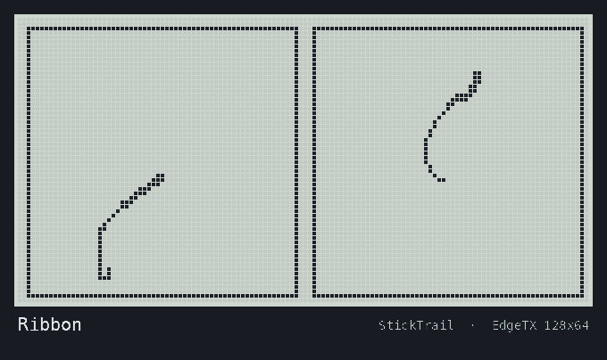

# StickTrail

Stick trails and a stick logger for EdgeTX 128x64 radios.

- `SCRIPTS/TOOLS/strail.lua`: trail visualizer. Run it from Tools, ENTER opens the menu.
- `SCRIPTS/FUNCTIONS/stlog.lua`: logs sticks at 20 Hz to `/LOGS/stNNN.csv` (`t_ms,yaw,pitch,throttle,roll`). Add a Special Function: arm switch → Lua Script → `stlog` → ON.

Copy `SCRIPTS` to the SD card. Set `STICK_MODE` at the top of `strail.lua` if you don't fly mode 2.
